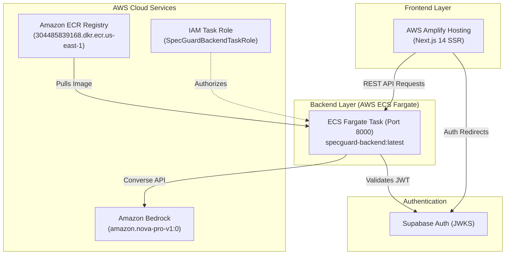

# SpecGuard Cloud Deployment Guide & Session Summary 🛡️

**Date**: October 22, 2026  
**AWS Account ID**: `304485839168`  
**Target AWS Region**: `us-east-1`  
**Container Registry (ECR)**: `304485839168.dkr.ecr.us-east-1.amazonaws.com/specguard-backend:latest`

---

## 1. Summary of Changes Made in the Codebase

### A. Health Check & Rate Limiting Fix
- **File**: `backend/main.py`
- **Change**: Removed `@limiter.limit("60/minute")` from `/health`.
- **Reason**: Cloud load balancers (AWS ALB, ECS Fargate health checks) poll `/health` every 5–15 seconds. SlowAPI rate-limiting caused health checks to fail with HTTP 429, triggering container crash/restart loops.

### B. Dynamic Port Binding
- **File**: `backend/Dockerfile`
- **Change**: Updated entrypoint to `CMD ["sh", "-c", "uvicorn main:app --host 0.0.0.0 --port ${PORT:-8000}"]`.
- **Reason**: Ensures compatibility across AWS container environments and platforms that inject dynamic `$PORT`.

### C. Next.js Standalone Optimization
- **Files**: `frontend/frontend/next.config.js` and `frontend/frontend/Dockerfile`
- **Change**: Added `output: 'standalone'` in Next.js config and updated Dockerfile to copy `.next/standalone`.
- **Benefit**: Reduced Docker image footprint from ~1 GB down to ~130 MB for significantly faster deployments and lower memory usage.

### D. Secret Scanning & Git Cleanup
- **File**: `.env.example`
- **Change**: Replaced real AWS credentials with dummy placeholders (`your_aws_access_key_id_here`).
- **Git History**: Performed a clean commit rewrite so GitHub Secret Scanning / Push Protection allows pushing to `main` without rejection.

### E. Cloud Configuration Files Created
- `amplify.yml`: Build definition for AWS Amplify Hosting.
- `aws/deploy.sh`: All-in-one shell script for building, authenticating, and pushing to Amazon ECR.
- `aws/ecs-task-def.json`: AWS ECS Fargate task definition with account ID `304485839168`.
- `aws/apprunner-service.json`: Service spec for AWS App Runner.
- `aws/iam-bedrock-policy.json`: IAM policy granting `bedrock:InvokeModel` for Amazon Nova Pro.
- `.github/workflows/deploy.yml`: GitHub Actions pipeline for automated testing and container publishing.

---

## 2. Cloud Architecture



---

## 3. Step-by-Step Deployment Instructions

### Step 1: Push Backend Image to Amazon ECR (Via AWS CloudShell)

Open [AWS CloudShell](https://console.aws.amazon.com/cloudshell) (icon `>_` in the top AWS bar) and run:

```bash
# 1. Clone repository
git clone https://github.com/aikantic/specguard.git
cd specguard

# 2. Create ECR repository (if not already created)
aws ecr create-repository --repository-name specguard-backend --region us-east-1 2>/dev/null || true

# 3. Build backend container
docker build --platform linux/amd64 -t specguard-backend:latest -f backend/Dockerfile ./backend

# 4. Authenticate Docker with Amazon ECR
aws ecr get-login-password --region us-east-1 | docker login --username AWS --password-stdin 304485839168.dkr.ecr.us-east-1.amazonaws.com

# 5. Tag and push image
docker tag specguard-backend:latest 304485839168.dkr.ecr.us-east-1.amazonaws.com/specguard-backend:latest
docker push 304485839168.dkr.ecr.us-east-1.amazonaws.com/specguard-backend:latest
```

---

### Step 2: Deploy Backend to AWS ECS Fargate

1. **ECS Cluster**:
   * Open [AWS ECS Console](https://console.aws.amazon.com/ecs/v2/clusters).
   * Create cluster `specguard-cluster` with **AWS Fargate (serverless)**.

2. **Register Task Definition**:
   * Click **Task definitions** ➔ **Create new task definition with JSON**.
   * Paste the contents of `aws/ecs-task-def.json` and save.

3. **Create Service**:
   * Under `specguard-cluster`, click **Create service**.
   * Launch type: **FARGATE**.
   * Family: `specguard-backend-task`.
   * Desired tasks: `1`.
   * Security Group: Allow Custom TCP on port `8000` from `0.0.0.0/0`.
   * Public IP: **Enabled**.

4. **Verify Health**:
   * Copy the public IP from the running task.
   * Visit `http://<PUBLIC_IP>:8000/health` in your browser. Expected: `{"status": "ok"}`.

---

### Step 3: Deploy Frontend to AWS Amplify

1. Open [AWS Amplify Console](https://console.aws.amazon.com/amplify).
2. Click **Create new app** ➔ **Host web app** ➔ Select GitHub.
3. Select repository `specguard` and branch `main`.
4. Amplify automatically reads `amplify.yml`.
5. Under **Environment variables**, set:
   * `NEXT_PUBLIC_API_URL`: `http://<ECS_PUBLIC_IP>:8000`
   * `NEXT_PUBLIC_SUPABASE_URL`: `https://erjfircpaehnlmfrjqql.supabase.co`
   * `NEXT_PUBLIC_SUPABASE_PUBLISHABLE_KEY`: *(your Supabase anon key)*
6. Click **Save and deploy**.

---

### Step 4: Configure Supabase Auth Redirects

In the [Supabase Dashboard](https://supabase.com/dashboard) ➔ Project `erjfircpaehnlmfrjqql` ➔ **Authentication** ➔ **URL Configuration**:
* **Site URL**: `https://main.xxxx.amplifyapp.com`
* **Redirect URLs**: `https://main.xxxx.amplifyapp.com/**`

---

## 4. Key Configuration Reference

| Variable | Recommended Value | Purpose |
| :--- | :--- | :--- |
| `AWS_REGION` | `us-east-1` | AWS deployment region |
| `BEDROCK_MODEL_ID` | `amazon.nova-pro-v1:0` | Amazon Bedrock AI impact reasoning model |
| `PORT` | `8000` | FastAPI HTTP listening port |
| `FRONTEND_ORIGIN` | `*` or Amplify URL | CORS permitted origins |
| `SUPABASE_JWKS_URL` | `https://erjfircpaehnlmfrjqql.supabase.co/auth/v1/.well-known/jwks.json` | Token verification |
