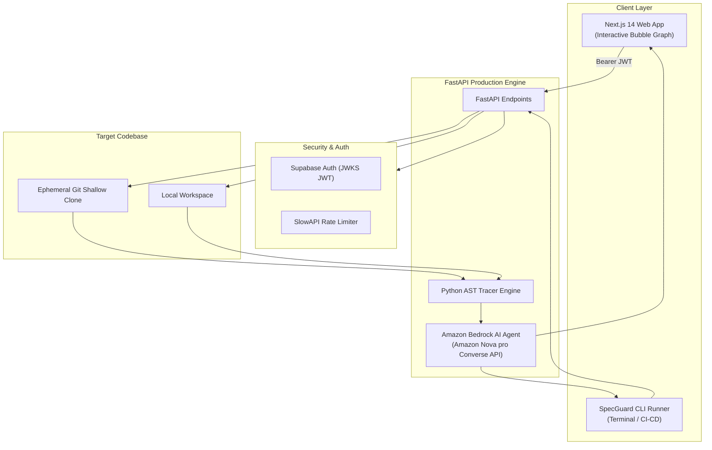

# SpecGuard 🛡️

### AI-Assisted Code Change Impact Analysis & Blast-Radius Engine

[](https://www.python.org/)
[](https://nextjs.org/)
[](https://fastapi.tiangolo.com/)
[](https://aws.amazon.com/bedrock/)
[](https://podman.io/)
[-brightgreen?logo=pytest&logoColor=white)](https://docs.pytest.org/)
[](LICENSE)

> **SpecGuard shows developers what may break *before* they change code by turning repository relationships into an interactive blast-radius map powered by Python AST analysis and Amazon Bedrock.**

---

## 📌 The Problem

Developers frequently modify functions, classes, configuration parameters, or service contracts without knowing every downstream part of the codebase that depends on them.

Text-based tools like `grep` return cluttered lists of string matches without understanding architectural context or dependency paths. The result:
- 💥 **Unexpected runtime regressions** in production
- 🔍 **Missed tests** and broken integration flows
- ⏳ **Slow, risky, and stressful code reviews**
- ❓ Unclear code ownership and blast radius

---

## 💡 The Solution

SpecGuard takes any public GitHub repository or local codebase along with a target Python symbol:
1. **Dynamic AST Indexing**: Traverses Abstract Syntax Trees across all Python source files to resolve class definitions, async functions, direct imports, aliases, and attribute accesses.
2. **Blast-Radius Scoring**: Computes deterministic blast scores and assessed risk levels (`LOW`, `MEDIUM`, `CRITICAL`).
3. **Interactive Bubble Graph**: Renders affected files as a non-overlapping concentric bubble map with line-by-line source evidence.
4. **🤖 Amazon Bedrock AI Agent**: Uses Anthropic Claude 3.5 Sonnet on Amazon Bedrock to synthesize findings into breaking change predictions and copy-pasteable regression test suites.
5. **💻 Standalone CLI & Quality Gate**: Run audits directly from your terminal or block risky PRs in CI/CD pipelines with `--exit-code`.

---

## 🏗️ Architecture



---

## ✨ Features

- ⚡ **Full Python AST Resolution**:
  - `ClassDef` & `AsyncFunctionDef` detection
  - `Import` & `ImportFrom` tracking (including `as` aliases)
  - `Attribute` property accesses & `Name` symbol references
  - Intelligent directory pruning (`.venv`, `__pycache__`, `.git`) for millisecond traversal
- 🤖 **Amazon Bedrock AI Agent**:
  - Integrated via AWS Bedrock Converse API (`anthropic.claude-3-5-sonnet-20240620-v1:0`)
  - Generates executive impact summaries and predicts breaking change vulnerabilities
  - Recommends targeted `pytest` regression commands for affected modules
  - Offline intelligent heuristic fallback when AWS credentials are not configured
- 🌐 **Interactive Graph Visualization**:
  - Non-overlapping tiered concentric bubble canvas
  - Real-time search and filter to isolate specific affected files
  - Slide-down evidence panel with line numbers and syntax snippets
- 💻 **Standalone CLI Tool**:
  - Colored ANSI terminal banner (`--format pretty`)
  - Machine-readable JSON output (`--format json`)
  - Ready-to-paste GitHub PR Markdown tables (`--format markdown`)
  - CI/CD quality gate mode (`--exit-code`)
- 🛡️ **Hardened Backend API**:
  - SlowAPI rate limiting (`5/min` audit, `15/min` agent, `30/min` auth, `60/min` health)
  - Multi-origin CORS support for local dev and AWS hosted domains
  - Sanitized git clone commands with `--` argument injection protection
  - Authenticated GitHub PAT support for private repos and higher rate limits
- 🐳 **Container Ready**:
  - Multi-stage Alpine Dockerfiles tested and verified with **Podman** and **Docker**
  - Rootless non-root container users for production security

---

## 🚀 Quick Start

### Option 1: Using the Standalone CLI (Fastest)

No servers needed! Analyze local codebases or remote GitHub repositories immediately:

```bash
# Clone the repository
git clone https://github.com/your-username/specguard.git
cd specguard

# Setup virtual environment
cd backend
python3 -m venv .venv
source .venv/bin/activate
pip install -r requirements.txt
cd ..

# 1. Audit a local folder
./specguard --path ./backend --symbol ASTTracer

# 2. Audit a remote GitHub repository
./specguard --repo encode/uvicorn --symbol Config --origin config.py

# 3. Run with the Amazon Bedrock AI Impact Agent
./specguard --path ./backend --symbol ASTTracer --agent --intent "Refactoring ASTTracer to stream output"

# 4. Output as JSON or Markdown (ready for PR comments)
./specguard --path ./backend --symbol ASTTracer --format json
./specguard --path ./backend --symbol ASTTracer --agent --format markdown
```

---

### Option 2: Running Full-Stack with Podman / Docker

```bash
# Copy example environment variables
cp .env.example .env

# Start both Backend (port 8000) and Frontend (port 3000)
podman-compose up --build
# or
docker compose up --build
```

- **Frontend Dashboard**: [http://localhost:3000](http://localhost:3000)
- **Backend API Docs**: [http://localhost:8000/docs](http://localhost:8000/docs)
- **Health Check**: [http://localhost:8000/health](http://localhost:8000/health)

---

### Option 3: Manual Local Development

#### 1. Backend (FastAPI)
```bash
cd backend
python3 -m venv .venv
source .venv/bin/activate
pip install -r requirements.txt

# Run server on port 8000
uvicorn main:app --reload --port 8000
```

#### 2. Frontend (Next.js 14)
```bash
cd frontend/frontend
npm ci
cp .env.local.example .env.local
npm run dev
```

---

## 💻 CLI Reference Manual

```text
usage: specguard [-h] (--repo REPO | --path PATH) --symbol SYMBOL
                 [--origin ORIGIN] [--format {pretty,json,markdown}]
                 [--agent] [--intent INTENT]
                 [--github-token GITHUB_TOKEN] [--exit-code]

Options:
  -h, --help            Show this help message and exit
  --repo, -r REPO       Public GitHub repository URL (e.g. 'encode/uvicorn')
  --path, -p PATH       Path to a local codebase directory to index directly
  --symbol, -s SYMBOL   (Required) Target identifier symbol to trace
  --origin, -o ORIGIN   Origin file defining symbol to exclude (e.g. 'config.py')
  --agent, -a           Run Amazon Bedrock AI Agent (Claude 3.5 Sonnet)
  --intent, -i INTENT   Planned change description provided to the Bedrock agent
  --format, -f FORMAT   Output format: pretty (default), json, markdown
  --github-token, -t    GitHub PAT for private repos & avoiding IP rate limits
  --exit-code           Exit 1 on CRITICAL risk, 2 on MEDIUM, 0 on LOW (CI/CD)
```

---

## 📡 API Endpoints

| Method | Endpoint | Rate Limit | Description |
| :--- | :--- | :---: | :--- |
| `POST` | `/api/audit/real-repo` | 5 / min | Clones target GitHub repo & indexes Python AST blast radius. |
| `POST` | `/api/audit/explain-agent` | 15 / min | Amazon Bedrock AI agent break-prediction & test generation. |
| `GET` | `/api/audit/history` | 30 / min | Retrieves user audit scan history. |
| `GET` | `/api/auth/me` | 30 / min | Returns authenticated Supabase user identity. |
| `GET` | `/health` | 60 / min | Container health check endpoint. |

---

## 🧪 Testing

SpecGuard includes an automated unit test suite covering AST parsing, node extraction, path filtering, CLI execution, and Bedrock agent synthesis:

```bash
cd backend
./.venv/bin/pytest tests/ -v
```

```text
tests/test_ast_tracer.py::test_ast_tracer_captures_all_node_types PASSED [ 25%]
tests/test_ast_tracer.py::test_origin_file_suppression PASSED            [ 50%]
tests/test_ast_tracer.py::test_cli_local_scan_json_output PASSED         [ 75%]
tests/test_ast_tracer.py::test_bedrock_impact_agent PASSED               [100%]

============================== 4 passed in 0.25s ===============================
```

---

## ☁️ AWS Hackathon Deployment Architecture

For deployment on AWS:

| Component | AWS Service | Purpose |
| :--- | :--- | :--- |
| **Frontend** | **AWS Amplify** | Serverless Next.js 14 deployment with global CDN edge hosting. |
| **Backend API** | **AWS App Runner / ECS Fargate** | Fully managed containerized FastAPI backend with auto-scaling. |
| **AI Agent** | **Amazon Bedrock** | Amazon Nova Pro via Converse API for architectural impact synthesis. |
| **Containers** | **Amazon ECR** | Secure, versioned container image registry. |
| **Secrets** | **AWS Secrets Manager** | Manages Supabase JWKS and AWS credentials. |
| **Observability**| **Amazon CloudWatch** | Structured API latency, error metrics, and rate limit telemetry. |

---

## 📄 License

This project is licensed under the MIT License — see the [LICENSE](LICENSE) file for details.
